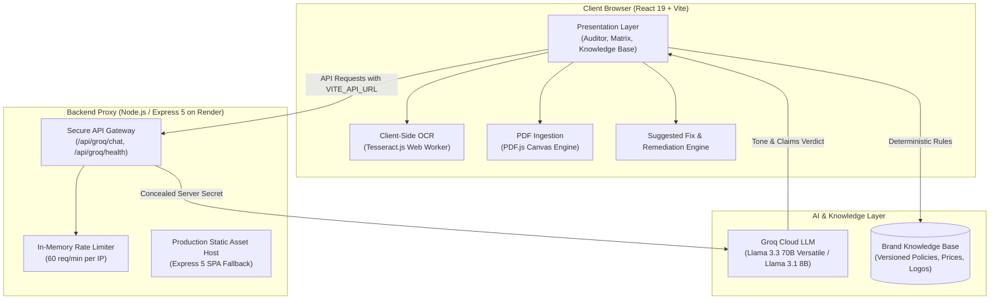

# BrandPilot Intelligence 🛡️
> **Evidence-Driven Brand Governance Before Publication**  
> *One approved source of truth. Every draft audited. People decide.*

[](https://react.dev/)
[](https://www.typescriptlang.org/)
[](https://vitejs.dev/)
[](https://groq.com/)
[](https://expressjs.com/)
[](LICENSE)

---

## 🌐 Live Deployments

- **Frontend (Vercel):** [https://brandpilot.vercel.app](https://brandpilot.vercel.app) *(or your deployed Vercel link)*
- **Backend API Proxy (Render):** [https://brandpilott.onrender.com](https://brandpilott.onrender.com)
- **GitHub Repository:** [https://github.com/tejask011/BrandPilott](https://github.com/tejask011/BrandPilott)

---

## 📑 Table of Contents
1. [The Problem Statement](#-the-problem-statement)
2. [The Solution: Four Modules](#-the-solution-four-modules)
3. [System Architecture](#-system-architecture)
4. [🖼️ Product Screenshots & Walkthrough](#️-product-screenshots--walkthrough)
5. [Key Features](#-key-features)
6. [Technology Stack](#-technology-stack)
7. [Getting Started & Local Setup](#-getting-started--local-setup)
8. [Testing & Quality Assurance](#-testing--quality-assurance)
9. [Honest Limitations & Roadmap](#-honest-limitations--roadmap)
10. [Team Veriqo](#-team-veriqo)

---

## 🚨 The Problem Statement

Content today is produced at unprecedented scale across decentralized hands: in-house marketers, external creative agencies, freelancers, and generative AI writing tools. Without unified governance, dangerous discrepancies quietly slip into production:
- **Financial & Price Drift:** An Instagram graphic advertises ₹1,099 while the official catalog and website list ₹1,299.
- **Unverified & Misleading Claims:** Superficial superlatives (*"India's #1 Most Loved Skincare"*) and unapproved medical guarantees (*"Results guaranteed in 7 days"*) expose brands to legal penalties under the **Consumer Protection Act 2019** and **CCPA 2022 Guidelines** (with penalties up to ₹50 lakh for repeat offenses).
- **Outdated Assets:** Creative teams routinely recycle deprecated logos, invalid promotional discount end-dates, or retired taglines.
- **The Approval Bottleneck:** Research indicates **88% of AI-generated enterprise copy requires substantial manual editing**, and marketing teams spend an average of **8 days waiting for cross-functional sign-offs**.

> **The Core Problem:** Today's brand governance is trapped between vague human reviews (*"make it more on-brand"*) and unreliable AI hallucinations. Reviewers waste hours hunting through PDF guidelines, while critical errors escape onto public channels.

---

## 💡 The Solution: Four Modules

BrandPilot Intelligence bridges the gap between approved company policy and what actually gets published through an integrated 4-module engine:

```
[ Module 1: Brand Knowledge Base ] ---> Single source of truth (prices, dates, claims, logos)
               |
               v
[ Module 2: Content Auditor ] -------> Exact checks in code + Groq AI for tone & claims
               |
               v
[ Module 3: Campaign Consistency ] --> Cross-asset checking across social, web, & print
               |
               v
[ Module 4: Governance Ledger ] -----> 1-click fixes, agency dispatch, & append-only audit trail
```

### 1. Brand Knowledge Base (The Single Source of Truth)
- Stores versioned brand truth: product catalog with active and historical pricing, valid-from and valid-until dates, approved and banned terminology, typography, color palettes, and official logo versions.
- Strict immutability: AI can read brand truth, but can **never** modify or invent company policy.

### 2. Evidence-Based Content Auditor
- **Deterministic Fact-Checking:** Numerical prices, promotional dates, SKU mappings, and banned words are audited by pure, mathematical code—ensuring zero LLM hallucinations.
- **Groq AI Tone & Claim Analysis:** Uses high-speed Llama 3.3 70B models to evaluate brand voice alignment and categorize advertising claims against four evidentiary labels:
  1. `Verified rule violation` (direct contradiction of an active policy)
  2. `No supporting evidence found` (unverified claim; never falsely labeled as "proven false")
  3. `Potential inconsistency` (low-confidence read or ambiguous wording)
  4. `Confirmed false claim` (directly refuted by established evidence)
- **Multi-Format Ingestion:** Instant client-side parsing of text drafts, PDF brochures (via PDF.js), and banner images with OCR extraction.

### 3. Campaign Consistency Engine
- Treats an entire campaign bundle (Instagram post, Website banner, Email copy, Print flyer) as an interconnected whole.
- Detects cross-channel price discrepancies, conflicting promotional expiry dates, and divergent taglines before publication.

### 4. Closed-Loop Remediation & Governance Ledger
- **One-Click Suggested Fixes:** Replaces flagged non-compliant phrases while carefully preserving the creator's natural voice, and appends mandatory legal disclaimers.
- **Agency Notification Dispatch:** Generates structured, polite revision emails ready to be sent to external creative agencies.
- **Decision Ledger:** Immutable audit trail recording every reviewer action (`APPROVED`, `DISPUTED`, `ESCALATED`) with guideline version snapshots.

---

## 🏗️ System Architecture



### Key Architectural Decisions:
1. **Hybrid Deterministic + LLM Pipeline:** An LLM is never allowed to judge a price or a date. Exact numbers and SKU codes are evaluated with deterministic code algorithms; Groq LLM inference is strictly used for linguistic nuance, tone scoring, and claim classification.
2. **Client-Side Heavy Parsing:** Image OCR rasterization and PDF parsing run in in-browser Web Workers, preventing unreleased creative assets from being stored on remote servers and eliminating processing latency.
3. **Secure API Shielding:** All Groq credentials remain strictly server-side inside the Express proxy with IP rate limiting, preventing API key exposure and prompt injection attacks.

---

## 🖼️ Product Screenshots & Walkthrough

<!-- Replace the placeholder paths below with your actual project screenshots -->

### 1. Evidence-Based Content Auditor with Bounding Box Pinning
*Inspects uploaded creative banners, highlights exact visual violation coordinates (pins ❶, ❷, ❸), and displays categorized evidentiary findings.*

```markdown

```
> *Placeholder: Add screenshot of Content Auditor showing the uploaded Instagram ad, pin overlays, and finding cards.*

---

### 2. One-Click Suggested Fix & Live Creative Remediation
*Reviewers can accept suggested fixes to automatically replace flagged copy and append mandatory legal disclaimers.*

```markdown

```
> *Placeholder: Add screenshot of Suggested Fix panel with "Accept & Apply Fix" and the updated compliant draft.*

---

### 3. Cross-Channel Campaign Consistency Matrix
*Compares multi-channel campaign assets (Instagram vs Web vs Print) to catch price divergence and promotional end-date drift.*

```markdown

```
> *Placeholder: Add screenshot of the Campaign Consistency View with the Cross-Asset Conflict Matrix.*

---

### 4. Brand Knowledge Base (Single Source of Truth)
*Manage brand colors, approved/historical product pricing, logo versions, and regulatory claim checklists.*

```markdown

```
> *Placeholder: Add screenshot of the Brand Memory / Guidelines Visualizer.*

---

### 5. Agency Correction Dispatch Modal
*Instantly drafts structured, polite correction emails detailing required fixes for creative agencies and designers.*

```markdown

```
> *Placeholder: Add screenshot of the Send-Back Email Modal.*

---

## ✨ Key Features

- [x] **Zero-Hallucination Exact Matching:** 100% reliable detection of price mismatches, expired promotions, and banned keywords.
- [x] **AI Tone & Claim Adjudication:** Real-time semantic analysis via Groq Cloud (`llama-3.3-70b-versatile`).
- [x] **Multi-Format Ingestion:** Drag-and-drop support for `.png`, `.jpg`, `.pdf`, and raw text copy.
- [x] **Visual Coordinate Overlays:** Precise spatial bounding-box pins placed directly over problematic ad copy.
- [x] **One-Click Non-Destructive Fixes:** Instant remediation that updates drafts without altering brand personality.
- [x] **Cross-Asset Discrepancy Matrix:** Multi-asset campaign analysis comparing social posts against brochures and landing pages.
- [x] **Audit Ledger:** Append-only decision record capturing who approved, disputed, or escalated findings.
- [x] **Agency Dispatch System:** Automated generation of revision emails with complete evidence links.
- [x] **Responsive Design:** Optimized layout for desktop monitors and mobile reviewer viewports.

---

## 🛠️ Technology Stack

| Layer | Technologies Used |
| :--- | :--- |
| **Frontend Framework** | React 19, TypeScript, Vite |
| **Styling & UI** | Tailwind CSS, Modern Vanilla Glassmorphism, Lucide React Icons |
| **Document Processing** | `pdfjs-dist` (client-side PDF rendering), `tesseract.js` (in-browser OCR) |
| **Backend Gateway** | Node.js, Express 5, TSX, CORS, Dotenv |
| **AI Inference** | Groq Cloud API (`llama-3.3-70b-versatile` with `llama-3.1-8b-instant` fallback) |
| **Cloud Deployment** | Vercel (Frontend CDN), Render (Backend Web Service) |

---

## 🚀 Getting Started & Local Setup

### Prerequisites
- **Node.js**: `v20.x` or `v22.x`
- **npm**: `v10.x`
- A free **Groq API Key** from [console.groq.com/keys](https://console.groq.com/keys)

### 1. Clone the Repository
```bash
git clone https://github.com/tejask011/BrandPilott.git
cd BrandPilott
```

### 2. Install Dependencies
```bash
npm install
```

### 3. Configure Environment Variables
Create a `.env` file in the project root:
```bash
cp .env.example .env
```

Add your Groq API key:
```env
# Server-side API key for Groq Cloud LLM proxy
GROQ_API_KEY=gsk_your_groq_api_key_here
PORT=3001

# Optional for local development (defaults to relative /api when blank)
# VITE_API_URL=http://localhost:3001
```

### 4. Run Both Servers (Client + Backend Proxy)
```bash
npm run dev:all
```
This starts:
- **Express Backend Proxy:** `http://localhost:3001`
- **Vite React Frontend:** `http://localhost:5173`

Visit `http://localhost:5173` in your browser. The top navigation bar badge should display **"Groq AI Active"**.

---

## 🧪 Testing & Quality Assurance

Run the comprehensive deterministic test suite:
```bash
# Run unit and regression tests
npm test

# Run linter
npm run lint

# Verify production bundle build
npm run build
```

---

## 🔍 Honest Limitations & Roadmap

In the spirit of honest engineering and hackathon transparency, we acknowledge what is currently in active development:

- **Campaign Consistency is an Early Prototype:** While single-ad auditing is fully operational, cross-campaign multi-file ingestion currently operates on structured sample batches. We are actively refining automated asset grouping for unlabelled multi-file uploads.
- **Complex Conditional Promotions:** The engine currently validates single numerical price points (e.g. ₹1,099 vs ₹1,299). Handling multi-tiered promotional logic (*"Buy 2 Get 10% Off"*, dynamic coupon codes, or geo-specific taxes) is slated for Round 3.
- **Stylized Font OCR Noise:** Highly decorative cursive scripts or ultra-small legal disclaimers (<6pt) placed at the bottom of social banners can produce dropped OCR characters.
- **Non-Destructive Graphic Fixes:** While our one-click fix updates the copy and disclaimers in text, human designers must still manually re-export the final raster image in Figma/Photoshop.

---

## 👥 Team Veriqo

Built with ❤️ for the **Inkloom AI Hackathon (Team WECODERS-48)** by students of **Pune Vidyarthi Griha's College of Engineering, Technology and Management (PVG's COETM), Pune**:

- **Tejas Kulkarni** *(Team Lead)* — Backend Architecture, Express 5 Proxy, Cloud Deployment (Render/Vercel), and Security Pipelines.
- **Yashashri Rajput** — Frontend UI/UX, Knowledge Base Visualizer, Responsive Mobile Layouts, and Asset Preview Engine.
- **Samruddhi Patil** — AI Inference Pipelines, Groq LLM Prompt Engineering, OCR Ingestion, and Deterministic Rule Verification.

---

## 📄 License
This project is open-source under the [MIT License](LICENSE).
